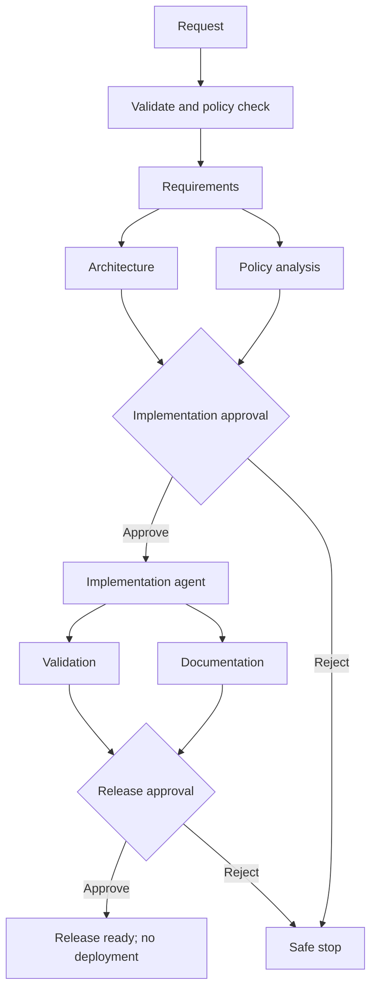

# Architecture and orchestration model

## Components

- **HTTP API (`server.py`)** parses bounded JSON requests, maps routes, and returns explicit status codes.
- **Shortener service (`shortener.py`)** validates destination URLs, generates opaque codes, enforces expiry, and records aggregate click counts.
- **SQLite (`database.py`)** stores links, workflow run snapshots, and append-only workflow events.
- **Orchestrator (`orchestrator.py`)** executes scenario DAGs, maintains state and context, synchronizes parallel stages, and pauses at approval gates.
- **Stage agents (`agents.py`)** implement a small replaceable contract. The included deterministic agent provides repeatable artifacts without credentials.
- **Policy engine (`policy.py`)** blocks unsafe requests before agent work and validates release outputs.
- **Rate limiter (`ratelimit.py`)** bounds POST traffic per direct peer address with a process-local sliding window.
- **Audit log (`audit.py`)** mirrors workflow transitions into hash-chained JSONL and exposes chain verification.
- **Artifact exporter** atomically writes each run snapshot and stage output under `artifacts/runs/<run_id>/`.

## Control flow

The ambiguous scenario inserts a human clarification gate before architecture. The brownfield scenario runs codebase analysis before architecture. Ready sibling nodes execute concurrently; dependent nodes wait for all declared predecessors. Approval is bound to the plan version and gate ID, so replanning invalidates stale approvals.

## State and lineage

Each run stores a versioned plan context, per-stage status and attempt count, stage artifacts, pending gate, start/end timestamps, and request. Each state transition emits an ordered event with timestamp, stage, actor (for human decisions), and structured details. Replanning increments the plan version, invalidates prior gates, clears downstream outputs, and reruns the graph from requirements. Events are retained for audit; snapshots provide current state.

SQLite is the queryable event ledger. A JSONL mirror stores each event with a SHA-256 hash chained to the previous record. `GET /api/orchestration/audit/verify` checks the chain. This local hash chain is tamper-evident, not immutable; production needs protected remote storage and reconciliation. Run snapshots and per-stage outputs are atomically written to the artifacts directory.

## Autonomy boundaries

Agents may produce proposed artifacts and validation evidence. They cannot deploy. Implementation and release are high-impact gates; ambiguous requirements add a clarification gate. Policy checks can block a run. Operators can approve, reject, replan, request bounded retry, rollback a stage artifact, or stop a run. Approval identity is a caller-provided label in this prototype and must be replaced with authenticated identity and authorization in deployment.

## Failure behavior and metrics

Stage execution retries at most `max_retries + 1` times, then can invoke one configured fallback agent. If both fail, the run stops in `failed`; a reviewer can request another bounded attempt. A safe stop prevents subsequent work. Rollback removes the selected stage artifact and all dependent artifacts, resets those stages to pending, and records the action; this is a state rollback only because the prototype has no external side effects. Metrics expose terminal-run success rate, internal and operator retries, rollback frequency, stage recovery interval, and average completed-run latency. Stage recovery interval is not a substitute for production incident MTTR.

## Key decisions

- SQLite and standard-library HTTP keep the prototype reproducible and runnable without external services.
- Named requirement, design, code, test, documentation, release, policy, clarification, and brownfield agents use deterministic implementations behind a routing interface; provider-backed agents can replace them.
- Random opaque short codes avoid leaking sequential volume.
- Only aggregate click data is persisted; no request metadata is retained.
- URL validation accepts HTTP(S), rejects credentials, and the service never fetches submitted URLs, avoiding server-side request forgery via preview.
- Release readiness is generated as a review artifact; no deployment side effect is allowed.
